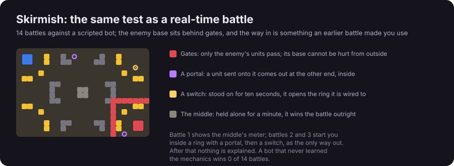
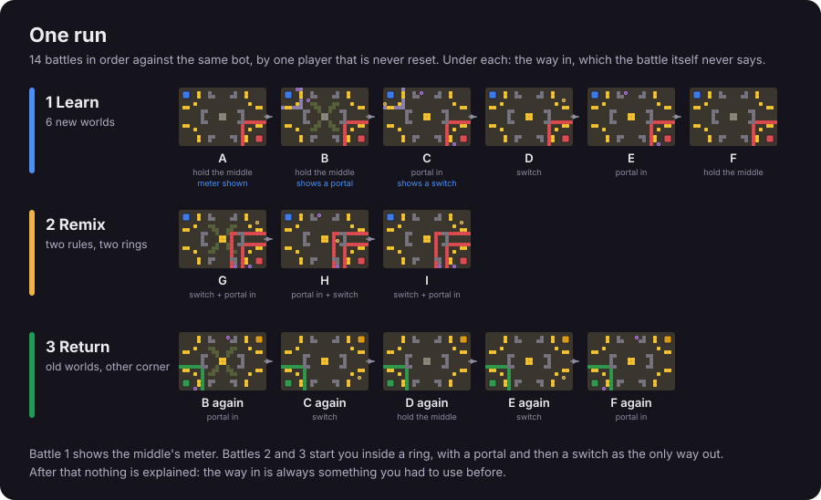
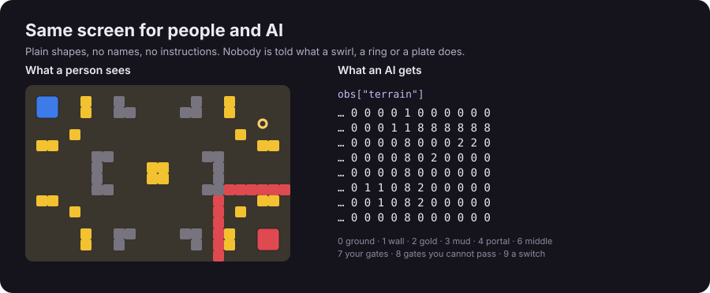
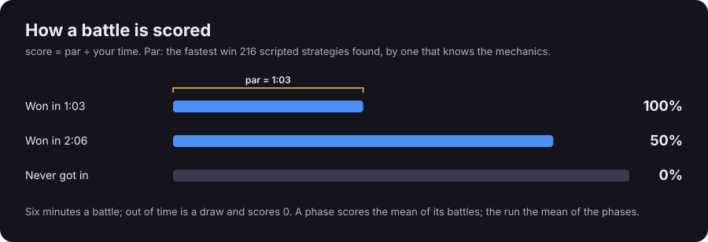
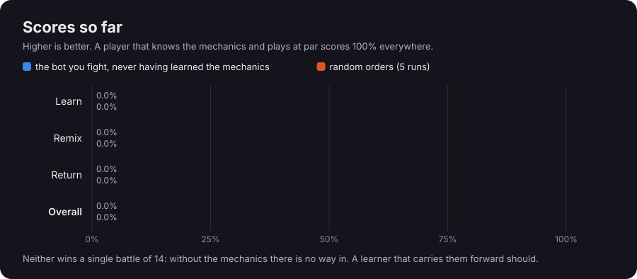

<p align="center"></p>

# Can an AI keep learning new games without forgetting the old ones?

<p align="center"></p>

<p align="center"></p>

People hold on to what they learn for years, and adapt when something familiar changes without throwing the rest away.
Neural networks trained on one thing after another tend to do the opposite: new learning overwrites old. Long Game
measures that with [Skirmish](https://www.clarkwhitehead.com/arcade/skirmish/?mode=test), a tiny real-time battle in
the spirit of StarCraft, easy for people and hard for AI, scored the way [ARC-AGI](https://arcprize.org/arc-agi)
scores: against people, with no instructions.

<br>

## One player fights one long run of battles, and is never reset.

<p align="center"></p>

<p align="center"></p>

Each world changes one hidden thing (mud, portals, archers, another way to win); remixes change two; return battles
bring old worlds back from another corner. Nothing is explained: before each battle the player may watch three example
battles between bots that know the world, then plays. People and AI see the same plain shapes.

<br>

### Every battle after the first can only be won with something an earlier battle taught.

<p align="center"></p>

The enemy base sits behind a ring of gates. The way in is a game mechanic: a portal that carries units inside, a
switch that opens the ring, or holding the middle. Each is first met by needing it (the player starts inside a ring
with a portal, then a switch, as the only way out), and from then on nothing says which one a battle needs. Not a code
to remember: a thing learned by playing. A player that did not learn it cannot win, so every win after the first is
proof that learning carried over, and, when the agent's context is wiped between battles, proof that it reached the
weights rather than a notebook.

<br>

#### Scores count only what carries over.

<p align="center"></p>

<p align="center"></p>

Par is the fastest win a search over 216 scripted strategies found, by one that knows the mechanics. The bot you fight
never learned them and wins no battle; random orders win none. A continual learner should, and that gap is the whole
point. Every battle is deterministic, so a recording of the orders is proof of a score.

<br>

##### Play it yourself, or write an agent in a few lines.

Play in the browser at [clarkwhitehead.com/arcade/skirmish/?mode=test](https://www.clarkwhitehead.com/arcade/skirmish/?mode=test).
An agent sees what a person sees, as numbers, and gives up to eight orders every half second of game time:

```python
from skirmish import Skirmish          # the harness ships with the site; this repo gets it in v0.3

with Skirmish() as env:
    obs = env.reset()                   # battle 1 of 14; obs["terrain"], obs["units"], obs["gold"], obs["meters"]
    while not obs["done"]:
        obs, result = env.step(choose(obs))   # orders: move, attack, gather, train, rally, hold, stop
    print(env.score())                  # learn, remix, return, overall
```

One object plays the whole run, so whatever it keeps between calls is its memory. Scores are reported in three tracks:
weights only (context wiped at every battle), bounded memory, and open.

<br>

###### What the earlier puzzle worlds tested, and where it lives now

Long Game began as a run of tiny grid puzzles (crates, keys, ice, switches, a mirrored twin). They are still in this
repository as the `longgame` Python package (v0.2, with its world maker), but the test is now Skirmish, which keeps
every part of them that mattered:

| Tested in the puzzle worlds | In Skirmish |
|---|---|
| One lifetime, never reset: learn, remix, return | One run of 14 battles: learn A–F, remix G–I, return B–F from another corner |
| No instructions; the same screen for people and AI | Plain shapes and numbers; three example battles instead of a rulebook |
| Par-based scores that count only what carries over | par ÷ time for a win, 0 for a loss or a draw |
| A baseline that forgets everything, to beat | The bot you fight, never having learned the mechanics: 0 of 14 |
| Solver-checked levels, so every one is possible | Every battle won by a scripted strategy that knows the mechanics (that win sets par) |
| Verifiable recordings | Deterministic battles: a recording of the orders replays the score |
| Held-out rules, so a high score is learning, not memorising | Coming: hidden battles with mechanics not in the public set |
| Gated levels: later levels unwinnable without earlier ones | Built in: every battle after the first |

###### Roadmap

- [x] v0.1: practice lifetime, browser player, verifiable recordings, baselines (grid worlds)
- [x] v0.2: the world maker, endless generated worlds with held-out rules (grid worlds)
- [x] Skirmish: the real-time battle, 14 gated battles, example battles, the never-learned baseline at 0
- [ ] v0.3: the Skirmish harness and recordings in this repository; more mechanics (bridges, keys, alarms)
- [ ] Hidden battles with held-out mechanics; human baselines; a leaderboard

[Contributing](CONTRIBUTING.md) · [Changelog](CHANGELOG.md) · [Cite](CITATION.cff) · MIT licence.
An independent project, not affiliated with the ARC Prize Foundation.
