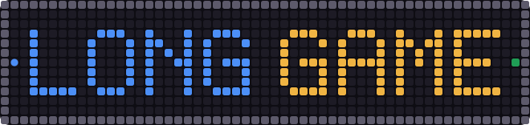
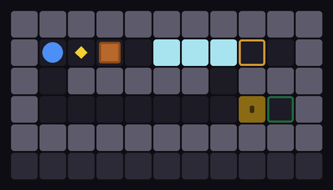
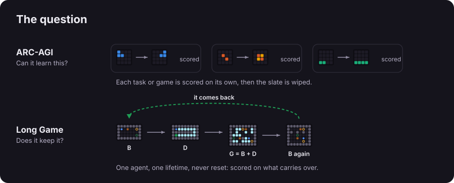
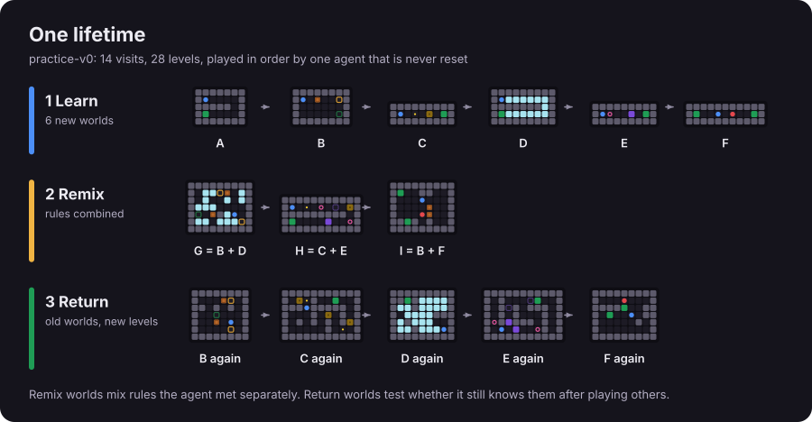
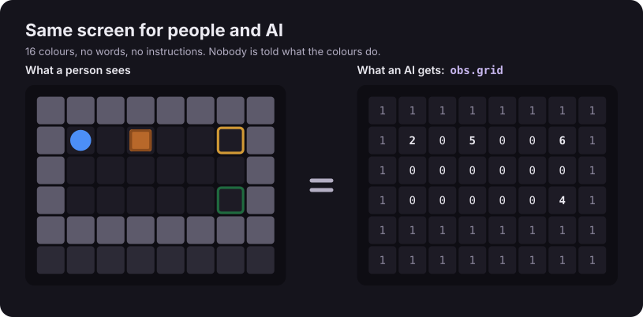
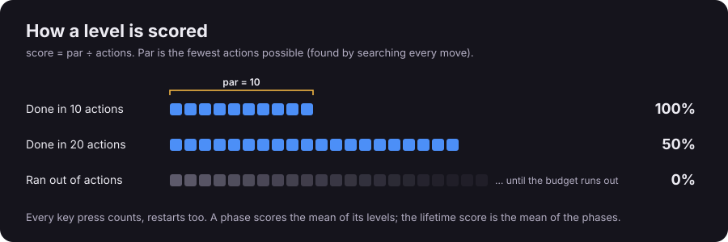
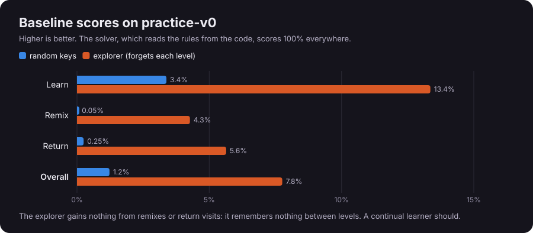
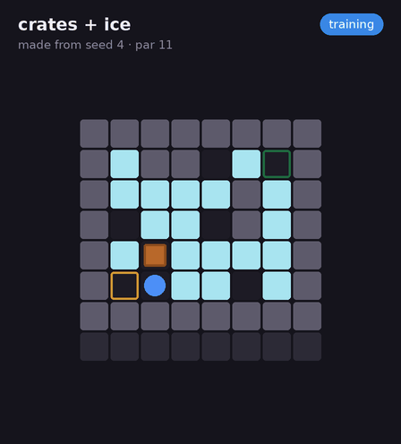
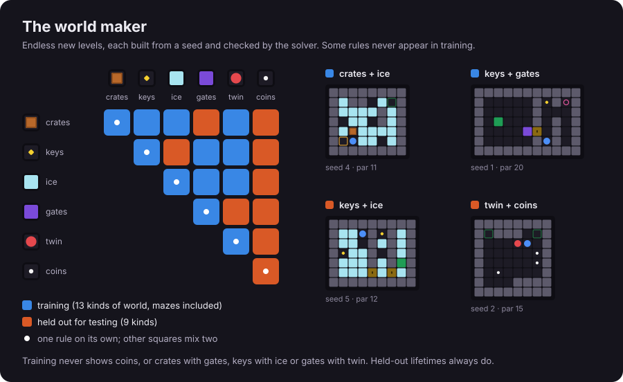
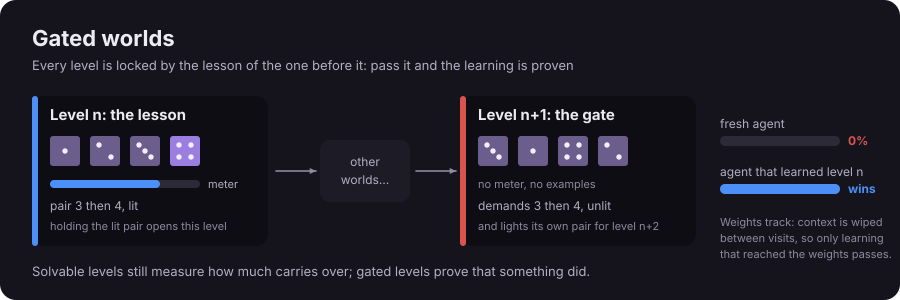

<p align="center"></p>

# Can an AI keep learning new games without forgetting the old ones?

<p align="center"></p>

<p align="center"></p>

People hold on to what they learn for years, and adapt when something familiar changes without throwing the rest away.
Neural networks trained on one thing after another tend to do the opposite: new learning overwrites old. Long Game
measures that, with games that are easy for people and hard for AI, in the spirit of [ARC-AGI](https://arcprize.org/arc-agi).

<br>

## One agent plays one long lifetime of tiny games, and is never reset.

<p align="center"></p>

<p align="center"></p>

No instructions: finishing a level is the only feedback. The agent is told when a new visit starts, but not which world
it is, so recognising an old friend is part of the test. The screen and keys match the ARC-AGI-3 format, so ARC-AGI-3
agents can play through a thin adapter.

<br>

### Scores count only what carries over.

<p align="center"></p>

<p align="center"></p>

Par is what a solver that knows the rules needs. The explorer searches each level from scratch, so it gains nothing on
remixes or return visits. A continual learner should, and that gap is the whole point. Recordings replay every action, so
a recording is proof of a score.

<br>

#### Endless worlds: a new lifetime from any seed, with rules held out for testing.

<p align="center"></p>

<p align="center"></p>

Every generated level is checked by the solver, so it is always possible. Train on as many lifetimes as you like, then
test on rule combinations the agent has never met: that split measures learning rather than memorising.

```python
import longgame

env = longgame.make("train-v1-42")       # any seed: a new 28-level lifetime, every level solver-checked
test = longgame.make("heldout-v1-42")    # rules kept out of training: test on these
```

<br>

#### Next: gated worlds, where only what you learned earlier can win.

<p align="center"></p>

Today every level can be finished from scratch, so earlier worlds only make an agent faster. A gated world adds a
hard test: the exit is behind a mechanic (a portal, a switch, a place to hold) that an earlier level made the agent
use, and nothing in the level says which. Not a code to remember: a thing learned by playing. An agent that did not
learn the earlier level scores zero, so a pass is proof that learning carried over, and in the weights track (context
wiped at every visit) proof that it reached the weights rather than a notebook. The whole chain is built into the
real-time Skirmish test on clarkwhitehead.com (every battle gated by what earlier battles taught); the world maker
gets it in v0.3.

<br>

##### Play it yourself, or write an agent in a few lines.

```bash
pip install "git+https://github.com/Nova-Rift/longgame"

longgame play            # play it yourself in the browser
longgame play train-v1-7 # a lifetime the world maker made from seed 7
longgame run explorer    # score a baseline agent
```

One object plays the whole lifetime, so whatever it stores between calls is its memory.

```python
from longgame import Action, Agent, evaluate

class MyAgent(Agent):
    def act(self, obs):          # obs.grid is the screen; obs.result says how the last level went
        return Action.UP         # 0 restart · 1 up · 2 down · 3 left · 4 right · 5 interact

if __name__ == "__main__":
    print(evaluate(MyAgent(), record="runs/mine.jsonl"))
```

```bash
longgame run my_agent.py:MyAgent --record runs/mine.jsonl
longgame verify runs/mine.jsonl  # replays every action: a recording is proof of a score
```

More in [examples/](examples/) (including [train, then test on held-out rules](examples/train_then_test.py)) and the
[API reference](docs/api.md).

| Also works with | |
|---|---|
| Gymnasium | `import longgame.gym` then `gym.make("LongGame/practice-v0")`, or `"LongGame/train-v1"` for a new generated lifetime every episode (needs `gymnasium`) |
| Any language | `longgame serve`: JSON lines on stdin/stdout ([Node example](examples/node_agent.mjs)) |
| ARC-AGI-3 agents | `longgame.arc.ArcEnvironment()` acts like the ARC toolkit's environment: `step(GameAction.ACTION1)` returns a `FrameData` with a 64 × 64 frame |

###### Roadmap

- [x] v0.1: practice lifetime, browser player, verifiable recordings, baselines
- [x] v0.2: the world maker, endless generated worlds for training, with held-out rules for testing
- [ ] v0.3: gated worlds (a glyph taught in one world is the only way to finish a later one; fresh agents score 0)
- [ ] More rules (gravity, conveyors, paint, chasers, …) for the world maker
- [ ] Changed-rule worlds and long gaps between visits
- [ ] ARC-style picture puzzles inside lifetimes
- [ ] Human baselines, hidden test lifetimes, a leaderboard

The full plan, and how every ARC-AGI test maps onto Long Game: [docs/design.md](docs/design.md).

---

[Contributing](CONTRIBUTING.md) · [Changelog](CHANGELOG.md) · [Cite](CITATION.cff) · MIT licence.
An independent project, not affiliated with the ARC Prize Foundation.
